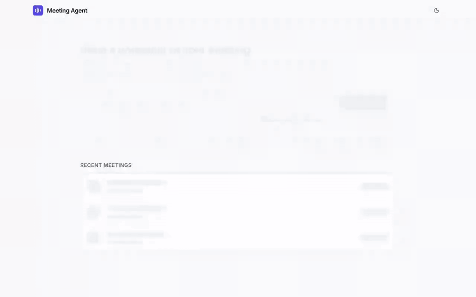
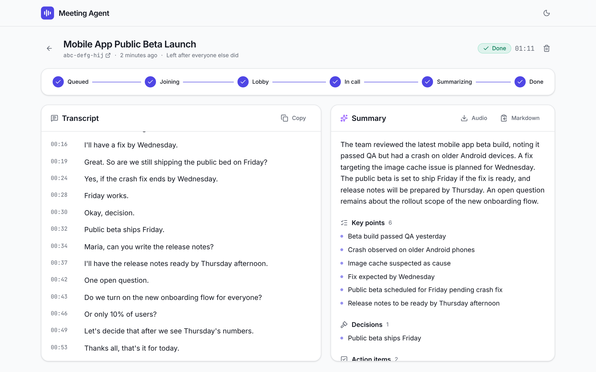
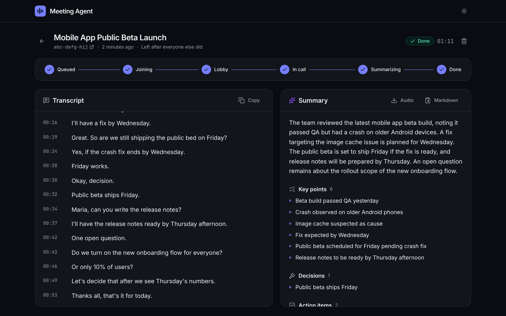
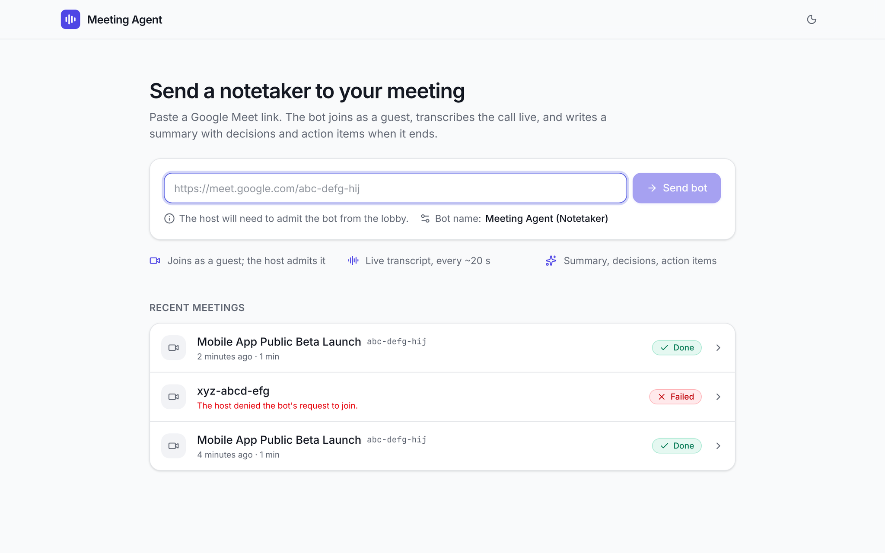
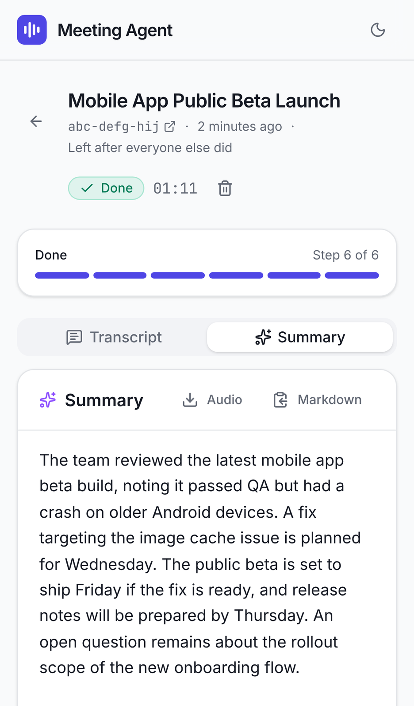
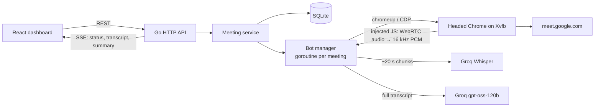

# Meeting Agent

A self-hosted notetaker bot for **Google Meet**. Paste a meeting link, and a bot joins as a guest, transcribes the call **live**, and writes a **summary with decisions and action items** when the meeting ends.

Go backend driving a real Chrome, a React dashboard, Groq Whisper for speech-to-text, and an LLM for the summary. It all ships as **one binary** (or one Docker image).



<sub>The demo runs against the bundled fake Meet (`cmd/fakemeet`), which plays a scripted stand-up in three synthetic voices. Speech-to-text and the summary are real Groq output. [MP4 version](docs/screenshots/demo.mp4).</sub>

## Features

- **Joins Google Meet as a guest** with an honest name ("Meeting Agent (Notetaker)"). The host admits it from the lobby like anyone else.
- **Live transcript** streamed to the browser over Server-Sent Events, about every 20 seconds.
- **Structured summary**: overview, key points, decisions, action items (owner and due date only when actually said), and open questions. Copy as Markdown.
- **Leaves on its own** when everyone else has left, the meeting ends, or a time limit is reached. You can also stop it from the dashboard.
- **Audio recording** (WAV) per meeting, downloadable.
- **Survives restarts**: graceful shutdown (the bot leaves, then finishes the transcript and summary); interrupted meetings are marked clearly.
- Works **offline for development**: fake speech-to-text/summary providers and a fake Meet page, so you can run everything without a Google account or API key.

| Meeting (light) | Meeting (dark) |
|---|---|
|  |  |

| Dashboard | Phone |
|---|---|
|  |  |

## How it works



1. **A real browser joins the call.** Meet blocks headless Chrome, so the bot runs a normal, *headed* Chrome on Xvfb (a virtual screen), driven from Go with [chromedp](https://github.com/chromedp/chromedp). An in-page probe reads the screen (pre-join, lobby, in call, denied, ended) and tags the buttons to click. Go clicks them with real input events. All Meet selectors live in [one file](internal/bot/meet/selectors.go).
2. **Audio is captured inside the page.** No PulseAudio or ffmpeg. A script injected before Meet loads wraps `RTCPeerConnection`, mixes every remote audio track with Web Audio, and an AudioWorklet downsamples to 16 kHz mono. Batches go straight to Go through `chromedp.ExposeFunc` ([capture.js](internal/bot/meet/inject/capture.js)).
3. **Transcribed in chunks, cut at pauses.** Audio is cut into chunks of about 20 s at the quietest moment near the boundary, so words aren't split. Silent chunks are skipped, and Whisper's well-known hallucinations ("Thank you.") are filtered out.
4. **Summarized with a strict JSON schema** (Structured Outputs), with map/reduce for long meetings.
5. **Everything is an event.** Each status change and transcript line is written to SQLite and published to an in-memory hub. The SSE endpoint replays missed lines on reconnect via `Last-Event-ID`.

The full design, with every decision and the reason for it, is in [`docs/PLAN.md`](docs/PLAN.md).

## Quick start

### Docker (recommended)

```bash
export GROQ_API_KEY=gsk_...        # optional: without it, fake providers are used
docker compose -f deploy/compose.yaml up --build
```

Open <http://localhost:8080>, paste a Meet link, and admit "Meeting Agent (Notetaker)" from the lobby. The image pins **Chrome for Testing**, runs Xvfb, and runs as a non-root user. Plan for about 0.5–1 GB of RAM per active bot.

### From source

Requirements: Go 1.26, Node 22, and Google Chrome or Chromium.

```bash
cp .env.example .env               # add GROQ_API_KEY
make build                         # builds the dashboard, then one Go binary
./bin/meeting-agent                # macOS/Windows: Chrome opens as a visible window
xvfb-run -a ./bin/meeting-agent    # Linux without a desktop
```

For development, `make dev` runs the Go server and the Vite dev server with hot reload.

### Try it without Google Meet

A local imitation of Meet ships with the project. It has the same buttons and labels, plus real WebRTC audio that plays a scripted stand-up:

```bash
go run ./cmd/fakemeet &            # http://localhost:9090/abc-defg-hij  (-deny to demo a failure)
ALLOWED_MEETING_HOSTS=meet.google.com,localhost:9090 CHROME_HEADLESS=true go run ./cmd/server
```

Then paste `http://localhost:9090/abc-defg-hij` into the dashboard. To test the bot alone from the command line, use `go run ./cmd/joinmeet -url <meet link>` (or `-fake`).

## Configuration

Set with environment variables (a `.env` file works too). The most useful ones:

| Variable | Default | |
|---|---|---|
| `GROQ_API_KEY` | none | Enables real transcription and summaries |
| `GROQ_STT_MODEL` | `whisper-large-v3-turbo` | |
| `GROQ_SUMMARY_MODEL` | `openai/gpt-oss-120b` | |
| `BOT_NAME` | `Meeting Agent (Notetaker)` | Default display name in the meeting |
| `MAX_CONCURRENT_BOTS` | `2` | Extra meetings wait as "queued" |
| `LOBBY_TIMEOUT` / `ALONE_TIMEOUT` / `MAX_MEETING_DURATION` | `10m` / `2m` / `2h` | |
| `DATA_DIR` | `./data` | SQLite database, recordings, failure screenshots |

All options are listed in [`.env.example`](.env.example) and [PLAN §12](docs/PLAN.md#12-configuration).

## API

| | |
|---|---|
| `POST /api/meetings` | `{"meeting_url": "...", "bot_name": "optional"}` → start a bot |
| `GET /api/meetings`, `GET /api/meetings/{id}` | List meetings / get one meeting with its summary |
| `GET /api/meetings/{id}/transcript` | All transcript segments |
| `GET /api/meetings/{id}/events` | **SSE** stream: `status`, `transcript`, `summary`, `error` |
| `POST /api/meetings/{id}/stop`, `DELETE /api/meetings/{id}` | Stop the bot / delete everything |
| `GET /api/meetings/{id}/audio` | Download the WAV |

```bash
curl -N localhost:8080/api/meetings/<id>/events
```

## Testing

```bash
go test ./...                       # unit tests, plus headless-Chrome tests against the fake Meet
E2E_GROQ=1 GROQ_API_KEY=... go test ./internal/api -run TestEndToEnd -v   # with real Groq
```

`TestEndToEnd` drives the whole system: HTTP API → bot in headless Chrome → fake Meet with real WebRTC audio → speech-to-text → summary → SSE stream. The fake Meet also copies Meet's traps: a "Leave call" button in the lobby, "Return to home screen" while waiting, and a pop-up covering the join button. Each trap is a regression test for a bug other bots have shipped.

## Project layout

```
cmd/server        HTTP server, wiring, graceful shutdown
cmd/joinmeet      CLI to test the bot against one meeting
cmd/fakemeet      Demo server imitating Google Meet
internal/bot      Chrome launch, bot manager, per-meeting pipeline
internal/bot/meet Google Meet adapter, selectors, injected JS, fake Meet
internal/audio    Reordering, pause-aware chunking, WAV, silence detection
internal/transcribe, internal/summarize   Groq clients + offline fakes
internal/meeting  Application service (DB + live events)
internal/api      REST, SSE, embedded SPA
internal/store    SQLite (goose migrations, sqlc queries)
web/              Vite + React 19 + TanStack Router/Query + Tailwind v4
deploy/           Dockerfile, entrypoint, compose
```

## Limitations

- **Google Meet only** for now. The code has a platform adapter interface, and Teams (guest web join) is the natural next one. Zoom has required user-attributed tokens for bots since March 2026.
- **No speaker names yet.** Meet mixes audio into a few shared channels, so "who said what" needs a different approach (active-speaker detection in the page).
- Meetings restricted to an organization don't accept guests.
- Meet's UI changes over time. When a join fails, the bot saves a screenshot to `data/debug/`, and the selectors are all in one file.

**Consent.** Recording people without consent is illegal in many places. The bot uses an obvious name and must be admitted by the host. Tell participants it's there.

## Tech

Go 1.26 · chromedp · SQLite (`modernc.org/sqlite`, sqlc, goose) · `net/http` + SSE · Groq (Whisper, gpt-oss-120b) · React 19 · TanStack Router + Query · Tailwind CSS v4 · Radix · Vite 8 · TypeScript 7 · Docker (Ubuntu 24.04 + Chrome for Testing + Xvfb)
